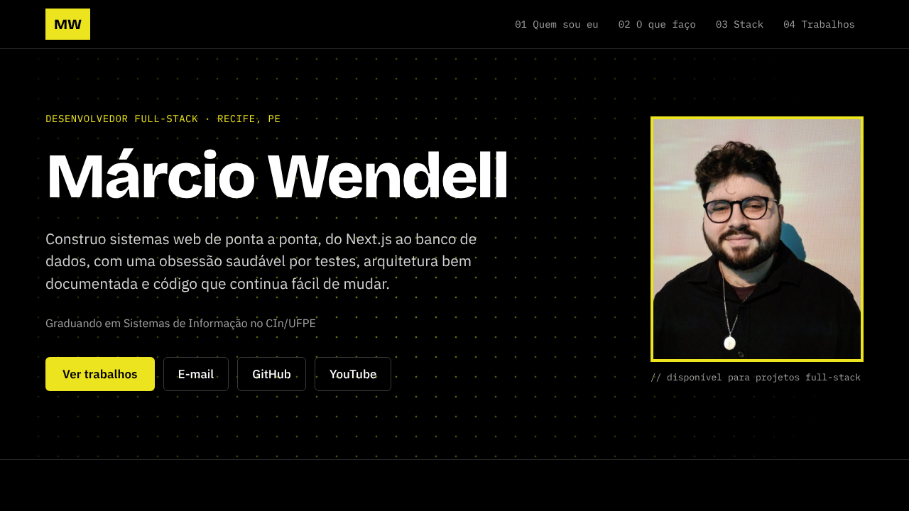

# Márcio Wendell · Portfólio

Portfólio pessoal de **Márcio Wendell**, desenvolvedor full-stack em Recife (PE).

**No ar:** [wenderu00.github.io](https://wenderu00.github.io)



## Stack

- [Next.js 16](https://nextjs.org) (App Router) com exportação estática (`output: "export"`)
- React 19 e TypeScript
- Tailwind CSS 4 com tokens de tema em `app/globals.css`
- [Motion](https://motion.dev) para animações de interface e [PixiJS 8](https://pixijs.com) para as cenas em canvas
- Playwright para testes E2E e `node:test` para testes do build
- GitHub Actions e GitHub Pages para CI e deploy

## Decisões

- **Site 100% estático.** Sem servidor nem banco: o build gera HTML, CSS e imagens em `out/`, publicados no GitHub Pages.
- **Conteúdo separado do layout.** Textos, projetos, stack e contatos ficam em `app/content.ts`; `app/page.tsx` só cuida da apresentação.
- **Motion para a interface, PixiJS para o canvas.** Motion cuida do que é DOM: reveals no scroll (em qualquer navegador), barra de progresso com mola, sublinhado do menu, filtro da stack, pipeline, nome que "decodifica", botões magnéticos e cards com inclinação. PixiJS desenha o que o DOM não aguenta: o campo de partículas do hero, o jardim da semeadura e o jogo de caçar mutantes da 404. O Pixi só é baixado depois que a página carrega, pausa fora da tela e, com `prefers-reduced-motion`, fica desligado (o hero volta à grade de pontos em CSS).
- **Acessibilidade como requisito.** Link para pular ao conteúdo, foco visível, menu mobile com `aria-expanded` e contraste alto no tema escuro.
- **Currículo gerado pelo próprio site.** A rota `/curriculo` monta o CV a partir de `app/content.ts`, e `npm run cv` imprime essa página em PDF (`out/curriculo-marcio-wendell.pdf`) com o Playwright. O PDF nunca fica desatualizado em relação ao site.
- **SEO.** Metadados Open Graph e Twitter, dados estruturados `Person` (JSON-LD), `sitemap.xml` e `robots.txt` gerados no build.

## Estrutura

```
app/
  content.ts        conteúdo do site (contato, serviços, stack, projetos)
  page.tsx          página única com as seções
  section-nav.tsx   menu de seções (hambúrguer no mobile)
  motion.tsx        componentes de animação com Motion
  stack-filter.tsx  filtro animado da stack
  seed-garden.tsx   jardim da semeadura (canvas)
  mutant-hunt.tsx   jogo da página 404 (canvas)
  pixi/             cenas PixiJS e o componente que as carrega sob demanda
  curriculo/        currículo para impressão (base do PDF)
  layout.tsx        fontes e metadados
  sitemap.ts        sitemap.xml
  robots.ts         robots.txt
scripts/
  generate-cv.mjs   gera o PDF do currículo a partir de out/curriculo.html
e2e/                testes Playwright (navegação, animações, CV, 404)
tests/              testes do HTML exportado
```

## Rodando localmente

Requer Node.js 24.

```bash
npm ci
npm run dev        # http://localhost:3000
```

## Testes

```bash
npm run lint       # ESLint
npm test           # faz o build e valida o HTML exportado em out/
npm run cv         # gera o PDF do currículo em out/ (rode npm test antes)
npm run test:e2e   # Playwright contra out/ (rode npm test e npm run cv antes)
```

Na primeira execução dos testes E2E, instale o navegador com `npx playwright install chromium`.

## Deploy

- Todo PR para `main` roda lint, testes do build, geração do currículo e testes E2E (`.github/workflows/ci.yml`).
- Todo push na `main` repete as verificações e publica `out/`, com o PDF do currículo, no GitHub Pages (`.github/workflows/deploy.yml`).

## Contato

- E-mail: [marcio.wendell.contact@gmail.com](mailto:marcio.wendell.contact@gmail.com)
- LinkedIn: [marcio-wendell](https://www.linkedin.com/in/marcio-wendell)
- GitHub: [@wenderu00](https://github.com/wenderu00)
- YouTube: [@MW_JS_Testing](https://www.youtube.com/@MW_JS_Testing)
